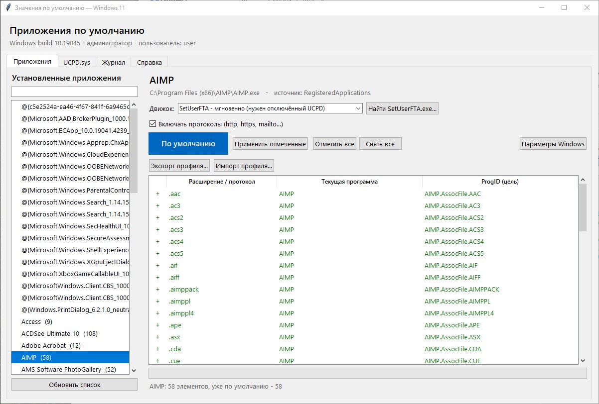
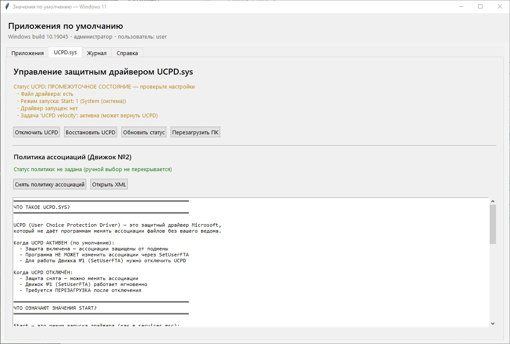

# Win11 Defaults Manager

[](https://www.python.org/downloads/)
[](https://www.microsoft.com/windows)
[](LICENSE)
[](https://github.com/chichilanov/Win11Defaults/releases)

Возвращает в Windows 10/11 функцию **«По умолчанию»** для всех расширений приложения одной кнопкой + управление защитным драйвером **UCPD.sys** + пакетное развёртывание через JSON-профили.

---

## ⚠️ Дисклеймер

Программа предназначена для опытных пользователей и системных администраторов. Использование осуществляется **на ваш страх и риск**. Автор не несёт ответственности за возможные последствия, включая, но не ограничиваясь:

- потерю данных или настроек системы;
- нестабильную работу операционной системы;
- повреждение реестра Windows;
- любые другие прямые или косвенные убытки.

Программа модифицирует реестр Windows и управляет системным драйвером `UCPD.sys`. **Перед использованием создайте точку восстановления системы.**

---

## 🎯 Возможности

- **Массовая установка ассоциаций** — одной кнопкой назначает приложению все его расширения и протоколы (в Windows 11 это приходится делать вручную для каждого формата).
- **Управление UCPD.sys** — отключает/включает защитный драйвер Microsoft, блокирующий изменение ассоциаций.
- **Два движка применения:**
  - **SetUserFTA** — мгновенно, без перезагрузки (требует отключённого UCPD);
  - **Политика Microsoft** — официально, через групповую политику (нужен повторный вход, перекрывает ручной выбор).
- **Пакетное развёртывание** — экспорт/импорт профилей в JSON для применения на множестве ПК.
- **Цветовая индикация** — сразу видно, что уже настроено, а что нет.
- **Две версии:** GUI (для двойного клика) и CLI (для скриптов и командной строки).

---

## 📸 Скриншоты

### Вкладка «Приложения»



### Вкладка «UCPD.sys» с цветовой индикацией



---

## 🚀 Быстрый старт

### Для домашнего пользователя (5 минут)

1. Скачайте архив из раздела [Releases](https://github.com/chichilanov/Win11Defaults/releases/tag/v2.2).
2. Распакуйте архив.
3. Запустите `Win11Defaults.exe` от имени администратора.
4. Вкладка **«UCPD.sys»** → **«Отключить UCPD»** → перезагрузка.
5. После перезагрузки: вкладка **«Приложения»** → выберите программу → **«По умолчанию»**.
6. (Опционально) Вкладка **«UCPD.sys»** → **«Восстановить UCPD»** → перезагрузка. Ассоциации при этом сохранятся.

### Для системного администратора

```bat
:: Шаг 1. Отключить UCPD на целевых ПК
Win11DefaultsCLI.exe --disable-ucpd --reboot

:: Шаг 2. После перезагрузки применить профиль (profile.json лежит рядом с exe)
Win11DefaultsCLI.exe

:: Шаг 3. (Опционально) Восстановить UCPD
Win11DefaultsCLI.exe --enable-ucpd --reboot
```

---

## 📦 Сборка из исходного кода

### Требования

- Windows 10/11
- Python 3.9 или новее
- PyInstaller (устанавливается скриптом сборки автоматически)
- `SetUserFTA.exe` (скачивается вручную)

### Пошаговая инструкция

1. **Установите Python** с [python.org](https://www.python.org/downloads/).
   ⚠️ **ВАЖНО:** при установке поставьте галочку **«Add Python to PATH»**.

2. **Склонируйте репозиторий:**

   ```bat
   git clone https://github.com/chichilanov/Win11Defaults.git
   cd Win11Defaults
   ```

3. **Скачайте SetUserFTA.exe** со [страницы автора](https://kolbi.cz/blog/) и положите в корень репозитория, рядом с `win11_defaults.py`.

4. **Запустите сборку:**

   ```bat
   build.bat
   ```

   Скрипт автоматически:
   - проверит наличие Python и PyInstaller;
   - установит PyInstaller, если его нет;
   - соберёт GUI-версию (`Win11Defaults.exe`);
   - соберёт CLI-версию (`Win11DefaultsCLI.exe`);
   - предложит создать ZIP-архив для распространения.

5. **Результат** — в папке `dist\`:
   - `Win11Defaults.exe` — GUI (без консоли);
   - `Win11DefaultsCLI.exe` — CLI (с консолью).

> `build.bat` сохранён в кодировке **OEM 866 без BOM**. Если правите его — сохраняйте в той же кодировке, иначе cmd.exe выдаст ошибки вида `'ersion' is not recognized...`.

### Локализация

Готовый релиз **скомпилирован на русской версии Windows**, все тексты интерфейса на русском. Если нужна версия на другом языке:

1. Откройте `win11_defaults.py` в текстовом редакторе (UTF-8).
2. Переведите строки с русским текстом.
3. Запустите `build.bat` — получите новый релиз на своём языке.

Тексты сосредоточены в:

- классе `MainWindow` — кнопки, метки, заголовки;
- константе `HELP_TEXT` — встроенная справка;
- функциях `ucpd_set`, `apply_sufta`, `apply_policy` — сообщения и статусы.

---

## 📖 Документация

Полное руководство — в файле [Win11Defaults-Manual.html](Win11Defaults-Manual.html) (откройте в браузере, можно сохранить в PDF через `Ctrl+P`).

### Ключи командной строки

| Ключ | Описание |
| --- | --- |
| `--help` | Показать справку |
| `--export [файл]` | Экспортировать текущие ассоциации в JSON |
| `--apply [файл]` | Применить JSON-профиль |
| `--engine sufta` | Использовать SetUserFTA (по умолчанию) |
| `--engine policy` | Использовать официальную политику Microsoft |
| `--disable-ucpd` | Отключить UCPD.sys |
| `--enable-ucpd` | Восстановить UCPD.sys |
| `--disable-policy` | Снять политику DefaultAssociationsConfiguration |
| `--reboot` | Перезагрузить ПК после выполнения команд |
| `--sufta PATH` | Указать путь к SetUserFTA.exe |

Если `--apply` указан без аргумента или не указан вовсе, программа ищет `profile.json` **в той же папке, где лежит exe**.

### Сравнение движков

| Характеристика | SetUserFTA | Политика Microsoft |
| --- | --- | --- |
| Скорость применения | Мгновенно | После входа в систему |
| Нужно отключать UCPD | Да | Нет |
| Права администратора | Не обязательны | Обязательны |
| Перекрывает ручной выбор | Нет | Да, при каждом входе |
| Следы в системе | Нет | XML + ключ в HKLM |
| Официальный механизм | Нет | Да |

---

## 🔧 Как это работает

### Проблема

В Windows 11 Microsoft убрала кнопку «По умолчанию» для приложения. Чтобы назначить программу для всех её форматов, нужно кликать по каждому расширению вручную: AIMP — 58 расширений, WinRAR — 29, Firefox — 33.

### Решение

1. **SetUserFTA** — записывает в `HKCU\...\FileExts\.ext\UserChoice` корректный `ProgId` вместе с хэшем (SID + расширение + ProgID + время записи ключа). Без правильного хэша Explorer сбрасывает ассоциацию.
2. **Политика DefaultAssociationsConfiguration** — официальный путь: XML со списком ассоциаций + ключ в `HKLM\SOFTWARE\Policies\Microsoft\Windows\System`.

### UCPD.sys

**UCPD (User Choice Protection Driver)** — драйвер Microsoft, блокирующий запись в `UserChoice` из сторонних процессов. Для работы SetUserFTA его временно отключают (`Start = 4`) вместе с задачей `UCPD velocity`, которая иначе возвращает драйвер обратно.

---

## 🛡️ Безопасность

- Работа только с реестром пользователя (HKCU) или политикой (HKLM).
- Системные файлы не модифицируются.
- Все изменения обратимы.
- Резервные копии ветки UCPD сохраняются в `%APPDATA%\Win11DefaultsManager\`.
- Исходный код открыт для аудита.

### Антивирусы и VirusTotal

Сборки PyInstaller с флагом `--uac-admin`, работающие с реестром и службами, часто вызывают **ложные срабатывания** эвристических движков (`Gen:Variant`, `Heur`, `Trojan.Generic`). Это известная проблема упаковщика, а не признак заражения.

Что делать:

- смотрите, **какие именно** движки ругаются: единичные эвристики при чистых Microsoft / Kaspersky / ESET / Dr.Web — это false positive;
- не доверяете готовой сборке — **соберите сами** из исходников, это и есть смысл открытого кода;
- хотите меньше детектов — соберите с `-D` вместо `-F` (папка вместо одного exe);
- можно отправить файл вендору как ложное срабатывание.

Ссылки на отчёты VirusTotal — в описании [последнего релиза](https://github.com/chichilanov/Win11Defaults/releases).

---

## 📋 Сценарии использования

| Сценарий | Как | Время |
| --- | --- | --- |
| Свой ПК | GUI: отключить UCPD → «По умолчанию» → восстановить UCPD | 5–10 минут |
| 10–50 ПК | Экспорт профиля → CLI на целевых машинах | 15–30 минут на ПК |
| Парк ПК через GPO | Startup Script с `deploy.bat` | Автоматически |
| Intune / SCCM | Win32-приложение, движок `policy` | Автоматически |

Подробные инструкции — в [документации](Win11Defaults-Manual.html).

---

## 🤝 Вклад в проект

Pull Request'ы приветствуются:

1. Fork репозитория.
2. Ветка: `git checkout -b feature/AmazingFeature`.
3. Коммит: `git commit -m "Add some AmazingFeature"`.
4. Push: `git push origin feature/AmazingFeature`.
5. Откройте Pull Request.

---

## 📄 Лицензия

MIT — см. файл [LICENSE](LICENSE).

---

## 🙏 Благодарности

- [SetUserFTA](https://kolbi.cz/blog/) (Christoph Kolbicz) — расчёт хэша UserChoice.
- [PyInstaller](https://pyinstaller.org/) — упаковка Python-приложений.
- Сообществу Windows IT Pro за разбор механизмов ассоциаций.

---

## 📧 Контакты

- Issues: [github.com/chichilanov/Win11Defaults/issues](https://github.com/chichilanov/Win11Defaults/issues)
- Releases: [github.com/chichilanov/Win11Defaults/releases](https://github.com/chichilanov/Win11Defaults/releases)

---

**Версия:** 2.2 · **Обновлено:** 25.11.2026 · **Совместимость:** Windows 10 (1809+), Windows 11
